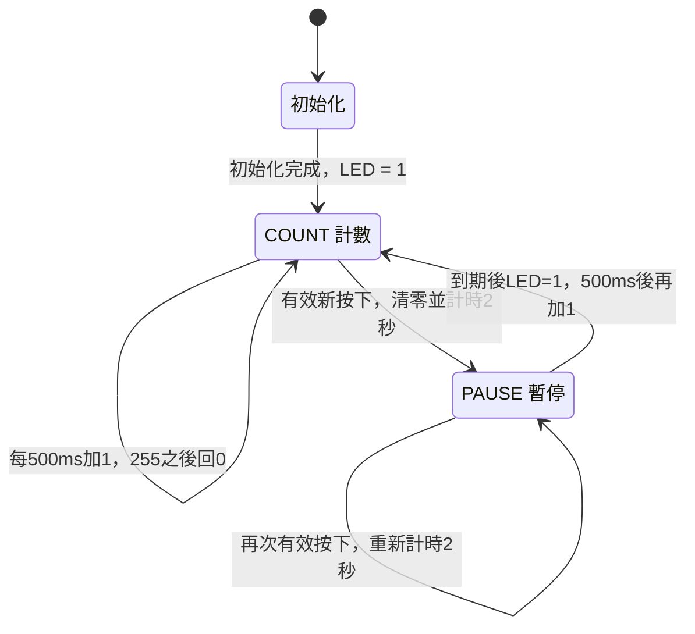

# EGO-XZ7 HW2：LED 計數與按鈕中斷

本實驗使用 Zynq 的 ARM 處理器控制八顆 LED 計數，並透過 PL 按鈕中斷完成清零、暫停與重新計數。

- LED 每 **500 ms** 加 1，以八位元二進位顯示，255 之後回到 0。
- 新的按下事件經 **20 ms 防彈跳**確認後，LED 與計數器清零，暫停約 **2 秒**，再從 1 計數。
- 五顆 PL 按鈕都已接入設計，實際上板測試範圍為 **S6**。
- 程式與電路使用 JTAG 載入揮發性記憶體，未寫入 Flash。

## 實驗環境與硬體架構

| 項目 | 設定 |
|---|---|
| 開發板 | EGO-XZ7 v1.0 |
| FPGA 器件 | `xc7z020clg484-1` |
| 開發版本 | Vivado 2018.3、Xilinx SDK 2018.3 |
| 處理器 | PS Cortex-A9 core 0 |
| LED | AXI GPIO 0，8-bit output，基底位址 `0x41200000` |
| 按鈕 | AXI GPIO 1，5-bit input，基底位址 `0x41210000` |
| 中斷 | `IRQ_F2P[0]`，本工程 GIC IRQ ID 為 61 |
| AXI 時脈 | FCLK0，50 MHz |
| UART 紀錄格式 | 115200 baud、8N1 |

ARM 透過 M_AXI_GP0 與 AXI Interconnect 存取兩個 GPIO。
按鈕 GPIO 的中斷經 GIC 交給 ISR。ISR 只清除 GPIO pending 並增加事件序號，防彈跳與 LED 更新均由主程式處理。
板卡 PS7 設定與 LED／按鈕 XDC 約束均包含在原始檔中。

## 主狀態機

主狀態以 C 程式的 `paused` 旗標控制。防彈跳與主狀態並行，等待 20 ms 時，COUNT／PAUSE 仍持續執行。



放開按鈕也會更新穩定狀態，讓下一次按下可以再次觸發。長按同一顆按鈕不會連續重設。
主程式確認新的按下後，無論當時為 COUNT 或 PAUSE，都會重設兩秒的暫停期限。

完整的事件與防彈跳邏輯見 [狀態機說明](docs/state_machine.md)。

## 實測結果

| 檢查項目 | 結果 |
|---|---|
| LED 自動計數 | 每0.5秒更新，顯示八位元二進位數值 |
| S6 按鈕中斷 | 兩次有效按下均完成清零、暫停及恢復計數 |
| 使用者觀察 | 確認 LED 熄滅約兩秒後重新計數 |
| DRC | 0 違規 |
| Setup 時序裕量 WNS | 13.008 ns |
| Hold 時序裕量 WHS | 0.030 ns |
| 成品一致性 | HDF 內的 Bitstream 與匯出 BIT 一致 |

實際 UART 紀錄節錄：

```text
Ready: GPIO IRQ 61; LED=1; count every 500 ms.
BUTTON=0x01: LED=0, pause 2 s (IRQ events 1).
Resume: LED=1
```

`0x01` 對應 S6。`IRQ events` 為事件序號，放開或彈跳也可能增加，無須等於按下次數。
原已測試的固定 `demo` 已完成實體上板；獨立資料夾重建的工程與 SDK 產物僅確認重建及編譯成功，仍需各自上板驗證。

## 專案內容

| 位置 | 內容 |
|---|---|
| [`firmware/hw2_demo/main.c`](firmware/hw2_demo/main.c) | 計數、GPIO 中斷、防彈跳與暫停控制 |
| `constraints/` | LED 與 PL 按鈕腳位、電壓約束 |
| `reference/` | PS7 參數與參考來源 |
| `scripts/` | 工程重建、硬體匯出、程式載入與完整性驗證原始碼 |
| `demo/` | 原已上板驗證的固定 BIT、PS 初始化 Tcl 與 ELF |
| `export/` | 硬體平台 BIT／HDF |
| [`docs/state_machine.md`](docs/state_machine.md) | 主狀態機與防彈跳設計 |
| [`docs/EGO_XZ7_HW2_Report.docx`](docs/EGO_XZ7_HW2_Report.docx) | 實驗報告 |
| `evidence/` | 上板、UART、DRC 與時序紀錄的公開副本 |

`demo` 三件組屬同一個已測試版本。新硬體的 BIT、HDF、初始化設定與 ELF 必須相互配對。
公開紀錄已移除線材序號與原電腦主機名稱。檔案大小及 SHA256 記錄於 `MANIFEST_SHA256.json`。

## 參考資料

板卡資料、參考工程與固定 commit 列在 [設定來源](reference/SOURCES.md)，第三方產生檔說明列在 [THIRD_PARTY_NOTICES.md](THIRD_PARTY_NOTICES.md)。
