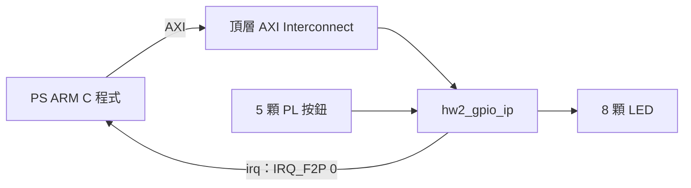

# EGO-XZ7 HW2：自己的 GPIO 子系統 IP

本版將 LED GPIO、按鈕 GPIO 與 AXI Interconnect 封裝成 **hw2_gpio_ip 1.0**，可在新工程的 IP Catalog 加入使用。底層 GPIO 採 Xilinx AXI GPIO 2.0，自己的成果是子系統介面、位址配置、整合與封裝。

ARM 的 C 程式繼續負責每 500 ms 計數、20 ms 防彈跳、按下後清零與暫停 2 秒，再從 1 恢復。COUNT／PAUSE 狀態機執行在 ARM。

## 架構與介面

| 項目 | 本版設定 |
|---|---|
| 開發板／器件 | EGO-XZ7 v1.0，xc7z020clg484-1 |
| 工具 | Vivado／Xilinx SDK 2018.3 |
| IP 識別 | f115112124.org:user:hw2_gpio_ip:1.0 |
| Catalog 顯示名稱 | HW2 LED and Button GPIO |
| AXI | AXI4-Lite，32-bit data，17-bit local address |
| 位址視窗 | 0x41200000～0x4121FFFF，128 KiB |
| LED GPIO | 偏移 0x00000，8-bit output |
| 按鈕 GPIO | 偏移 0x10000，5-bit input，中斷啟用 |
| 時脈 | FCLK0 50 MHz |
| 中斷 | irq 接 IRQ_F2P[0]，新 HDF 確認 ID 61／LEVEL_HIGH |

內層 GPIO 封裝後不會成為 HDF 的獨立周邊，因此使用 [`hw2_gpio.h`](firmware/hw2_demo/hw2_gpio.h) 透過 Xil_In32／Xil_Out32 存取暫存器。ISR 先讀 pending，再以 Toggle-On-Write 清除現有通知，並記錄事件序號。所有等待與 LED 更新都由主程式處理。

## 驗證結果與範圍

| 項目 | 新封裝版結果 |
|---|---|
| IP Packager／Catalog 重用 | 通過，於新工程建立 IP 並生成輸出 |
| Block Design | Validate 通過，映射 128 KiB |
| AXI／GPIO 功能模擬 | 通過 176 項 assertion，含重複協定穩定性檢查 |
| 硬體建置 | 合成、Implementation、Bitstream 完成 |
| DRC | 0 違規 |
| 設定的時序條件 | 通過，WNS 13.134 ns，WHS 0.034 ns |
| SDK | BSP／應用程式編譯完成 |
| HDF／BIT 一致性 | 嵌入的 BIT 與匯出 BIT 相同 |
| 新封裝版上板 | **尚待實板驗證** |

原本分立 GPIO 版本已觀察到 LED 計數、S6 清零與暫停恢復。本次沒有接上板子，原版結果不能當作新封裝版上板通過的證據。

## 專案內容

| 位置 | 內容 |
|---|---|
| [`ip_repo/hw2_gpio_ip_1_0`](ip_repo/hw2_gpio_ip_1_0) | component.xml、相對路徑 HDL、子 IP 與介面資訊 |
| [`docs/GPIO_IP_DESIGN.md`](docs/GPIO_IP_DESIGN.md) | IP 結構、暫存器與封裝說明 |
| [`firmware/hw2_demo/main.c`](firmware/hw2_demo/main.c) | ARM 主程式、GIC 與 ISR |
| [`firmware/hw2_demo/hw2_gpio.h`](firmware/hw2_demo/hw2_gpio.h) | 自訂 IP 的 MMIO 小型介面 |
| `scripts/` | 可重現封裝、主系統建置、硬體匯出與 SDK 建置來源 |
| `tests/` | 從 Catalog 建立 IP 的 AXI 功能測試平台 |
| `constraints/`、`reference/` | 腳位約束、PS7 參數及子系統 BD 重建來源 |
| `export/`、`demo_ip/` | 新封裝版配對成品，尚待上板 |
| [`docs/state_machine.md`](docs/state_machine.md) | ARM 計數與防彈跳狀態機 |
| `evidence/ip_revision/` | 新版 Catalog、模擬、HDF、編譯、DRC 與時序證據 |
| `demo/`、`evidence/` 根目錄原紀錄 | 原分立 GPIO 版的已測試成品與證據 |
| `docs/EGO_XZ7_HW2_Report.docx` | 原分立 GPIO 版實驗報告，保留作舊版本紀錄 |

新封裝版與舊版成品分開保留。BIT、HDF、PS 初始化及 ELF 必須同版配對。
完整軟體操作與搬機教學保留在本機手冊，不列入此公開倉庫。

板卡與第三方來源見 [`reference/SOURCES.md`](reference/SOURCES.md) 及 [`THIRD_PARTY_NOTICES.md`](THIRD_PARTY_NOTICES.md)。
