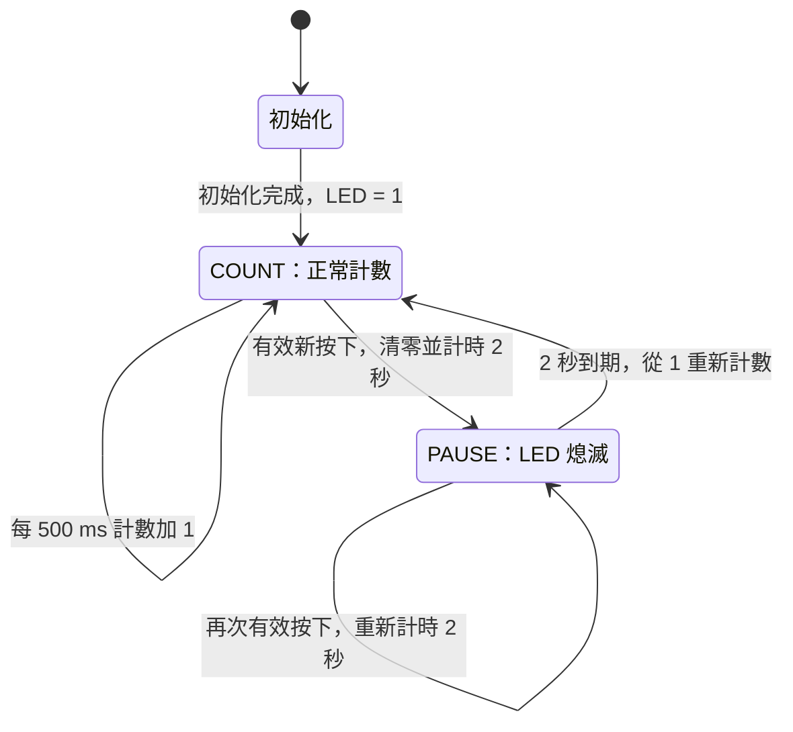

# EGO-XZ7 HW2：LED 計數與按鈕中斷

使用 EGO-XZ7 v1.0、Vivado 2018.3 與 Xilinx SDK 2018.3，讓 ARM 控制八顆 LED 計數，並透過 PL 按鈕中斷清零、暫停及重新計數。

- LED 每 **500 ms** 加 1，以八位元二進位顯示，255 之後回到 0。
- 按鈕經 **20 ms 防彈跳確認**後，LED 與計數器清零，暫停約 **2 秒**，再從 1 計數。
- 五顆 PL 按鈕都已接入設計。本次實際上板測試的是 **S6**，已確認能重複觸發及恢復計數。
- 採 **JTAG 暫存下載**，未寫入 Flash，板子斷電後需重新下載。

## 文件

| 文件 | 內容 |
|---|---|
| [逐步操作 PPT](guide/EGO_XZ7_HW2_Manual.pptx) | 共 42 頁，含 SDK 2018.3 實際介面、欄位填法、下載步驟與排錯。第 41–42 頁是狀態機與防彈跳圖。 |
| [簡明實驗報告](docs/EGO_XZ7_HW2_Report.docx) | 硬體架構、程式流程與上板結果。 |
| [另一台電腦操作說明](README_另一台操作.md) | 搬移、重建與展示指令。 |
| [START_HERE.txt](START_HERE.txt) | 下載後可用記事本開啟的操作入口。 |
| [設定來源](reference/SOURCES.md) | 板卡資料、參考工程與固定 commit。 |

## 軟體與硬體

| 項目 | 設定 |
|---|---|
| 開發板 | EGO-XZ7 v1.0 |
| FPGA 器件 | `xc7z020clg484-1` |
| 工具 | Vivado 2018.3、Xilinx SDK 2018.3，含 Zynq-7000 與 Cable Drivers |
| LED | AXI GPIO 0，8-bit output，基底位址 `0x41200000` |
| 按鈕 | AXI GPIO 1，5-bit input，基底位址 `0x41210000` |
| 中斷 | `IRQ_F2P[0]`，本工程 GIC IRQ ID 為 61 |
| UART | 115200、8 data bits、None parity、1 stop bit、無流量控制 |

工程包含手動 PS7 設定與 XDC，`BOARD_PART` 空白是預期狀態，無需另外安裝 EGO Board Files。軟體安裝位置可依電腦不同，以下操作統一將專案放在 `C:\soc_hw2`。

## 下載到另一台電腦

1. 在 GitHub 按 **Code**，選 **Download ZIP**。
2. 解壓縮後，將專案資料夾（例如 `EGO-XZ7-HW2-main`）改名為 `soc_hw2`，移到 `C:\`。
3. 確認直接存在 `C:\soc_hw2\export\design_1_wrapper.hdf`，避免多包一層 `soc_hw2`。
4. 安裝並啟動 Vivado／SDK 2018.3，接上板子電源與 USB-JTAG／UART 連線。

若使用先前提供的攜帶 ZIP，其最外層已是 `soc_hw2`，解壓到 `C:\` 即可。

## 快速展示：使用已測成功的成品

此方式使用 `demo` 裡固定的 BIT、PS 初始化 Tcl 與 ELF，不必先重跑硬體合成或編譯 C 專案。

1. 開啟板子電源，只接這一片 EGO-XZ7。結束其他正在控制板子的 Vivado Hardware Manager 或 SDK Debug 連線。
2. 在 Windows 裝置管理員確認 UART 的 COM 編號。另一台電腦不一定仍是 COM3。
3. 啟動 Xilinx SDK 2018.3，工作區可選 `C:\soc_hw2\sdk`。開啟 SDK Terminal，按綠色 `+`，使用上表的 UART 參數連線。
4. 在 SDK 主選單選 **Xilinx > XSCT Console**，輸入：

   ```tcl
   source C:/soc_hw2/scripts/run_prebuilt_demo.tcl
   ```

5. 看到 `HW2_DEMO_RUNNING` 後，確認 LED 每 0.5 秒更新。
6. 按一下 **A10 貼紙左側、十字按鈕組正中央的 S6**。LED 應熄滅約兩秒，再從 1 重新計數。

正常的 UART 訊息包括：

```text
Ready: GPIO IRQ 61; LED=1; count every 500 ms.
BUTTON=0x01: LED=0, pause 2 s (IRQ events 1).
Resume: LED=1
```

`IRQ events` 是事件序號，放開按鈕或彈跳也可能增加，無須等於按下次數。若只完成 Program FPGA，還需要初始化 PS、下載 ELF 並啟動 CPU，C 程式才會執行。

## 狀態機

主狀態由 PS 的 C 程式以 `paused` 旗標控制。防彈跳處理與主狀態並行，等待 20 ms 時，COUNT／PAUSE 仍繼續執行。



ISR 只清除 GPIO 中斷來源並累加事件序號。主程式觀察到事件變更後，等待約 20 ms 再讀取按鈕，確認新的按下才清零。長按同一顆按鈕不會連續重設，放開也會更新穩定狀態，讓下一次按下可以再次觸發。

## 重建 Vivado 工程

第一次建立時，啟動 Vivado 2018.3，保持沒有其他工程開啟，在 **Tcl Console** 輸入：

```tcl
source C:/soc_hw2/scripts/create_hardware_project.tcl
```

看到 `HW2_PROJECT_READY` 後，工程位於 `C:\soc_hw2\hardware\soc_hw2.xpr`。這一步只建立 Block Design、IP 輸出與 HDL wrapper。

後續可用 **File > Open Project** 開啟該 `.xpr`。需要新 Bitstream 時，執行 **Generate Bitstream**，成功後再於 Tcl Console 輸入：

```tcl
source C:/soc_hw2/scripts/export_hardware.tcl
```

看到 `HW2_EXPORT_OK` 後，`export` 中的 BIT／HDF 已更新。接著必須用新 HDF 更新 SDK 硬體平台，重新產生 BSP 與編譯應用程式。新的 `ps7_init.tcl` 由 SDK 硬體平台取得。

## 建立或重建 SDK 專案

先保存程式修改，並關閉正在使用同一個 workspace 的 SDK。從 SDK 2018.3 安裝目錄的 `bin` 開啟 `xsct.bat`，輸入：

```tcl
source C:/soc_hw2/scripts/create_sdk_workspace.tcl
```

這個腳本從 `firmware/hw2_demo/main.c` 建立或更新 `hw_platform`、`standalone_bsp` 與 `hw2_demo`。若先在 SDK 編輯過程式，請先把最新版複製回 `firmware/hw2_demo/main.c`，再執行腳本。

看到 `SDK_BUILD_OK` 後，ELF 位於 `C:\soc_hw2\sdk\hw2_demo\Debug\hw2_demo.elf`。重新開 SDK，選 `C:\soc_hw2\sdk` 工作區即可。GUI 的完整建立與 Debug 步驟見操作 PPT。

## 目錄與版本配對

| 目錄 | 用途 |
|---|---|
| `firmware/` | C 原始碼。 |
| `constraints/` | LED 與 PL 按鈕的腳位及電壓約束。 |
| `reference/` | PS7 板卡設定與來源說明。 |
| `scripts/` | 可攜重建、匯出、下載與驗證腳本。 |
| `demo/` | 原已上板驗證的固定 BIT、`ps7_init.tcl`、ELF 三件組。 |
| `export/` | 供 SDK 建立平台及後續硬體更新的 BIT／HDF。 |
| `guide/`、`docs/` | 操作 PPT 與實驗報告。 |
| `evidence/` | 上板、UART、DRC 與時序紀錄的公開副本。 |

`demo` 三件組需一起保留。更新 `export` 後，使用新 HDF 產生的平台、初始化檔與新編譯的 ELF，不要混用舊 `demo` 的 ELF／初始化檔。

本倉庫不攜帶 Vivado／SDK 安裝程式、舊 workspace 的 `.metadata` 或編譯快取。公開實驗紀錄會移除不必要的線材序號與原電腦主機名，保留測試結果。

## 驗證範圍

- 固定 `demo` 版本已在原電腦完成實體上板、S6 按鈕與 LED 暫停後恢復測試。
- 硬體 DRC 為 0 違規，已設定的時序約束通過，setup WNS 為 13.008 ns，hold 裕量為 0.030 ns。
- 可攜腳本已在獨立資料夾完成 Vivado 工程重建與 fresh SDK 編譯；重建產物與另一台電腦仍需各自上板確認。
- 五顆 PL 按鈕都已接入設計，實際按鍵測試範圍為 S6。

下載後可先用 Python 3 檢查套件完整性：

```text
python scripts/verify_package.py
```

檔案大小與 SHA256 記錄於 `MANIFEST_SHA256.json`。修改原始碼、文件或成品後，需重新產生雜湊清單。

參考資料與其來源保留在 [reference/SOURCES.md](reference/SOURCES.md)。
