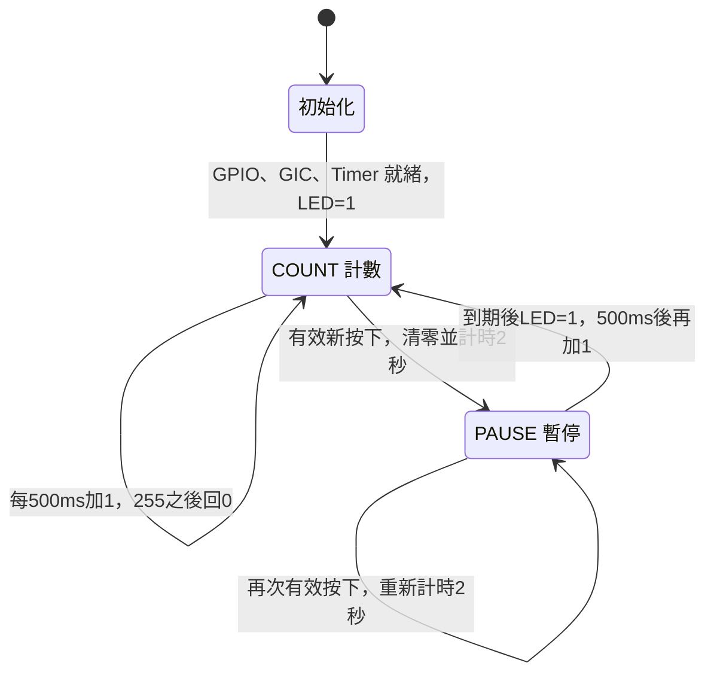
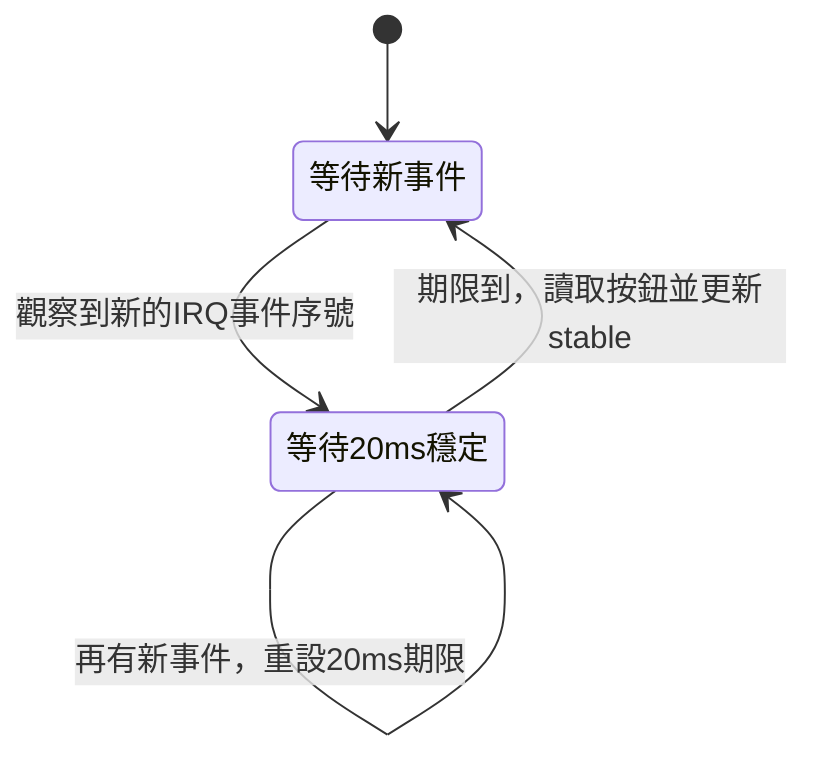

# LED 計數與按鈕中斷狀態機

狀態機執行在 PS 的 ARM C 程式，來源為 [`main.c`](../firmware/hw2_demo/main.c)。
`paused = 0` 表示 COUNT，`paused = 1` 表示 PAUSE。INIT 是啟動時執行一次的初始化流程。

按鈕中斷和防彈跳另行處理。ISR 清除 GPIO pending 並增加事件序號。
主程式觀察到序號改變後，將防彈跳期限設為現在加 20 ms。

到期時先計算 `pressed = current & ~stable & 0x1F`，再更新 `stable = current`。
`pressed` 非 0 才通知主狀態機。放開也會更新穩定狀態，長按同一顆按鈕不會連續重設。
等待防彈跳時，COUNT／PAUSE 仍持續執行。
